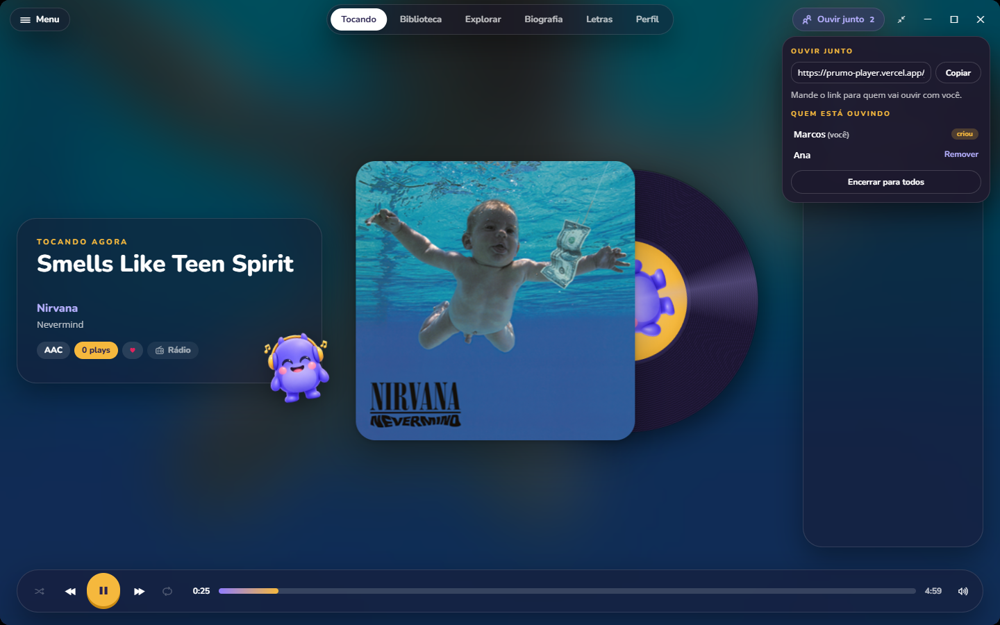
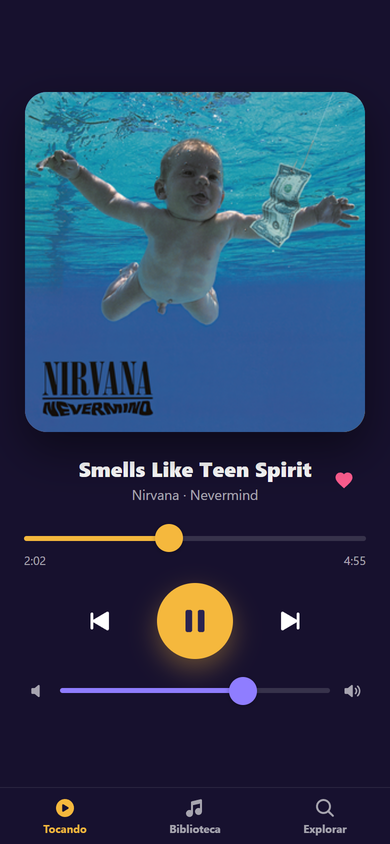
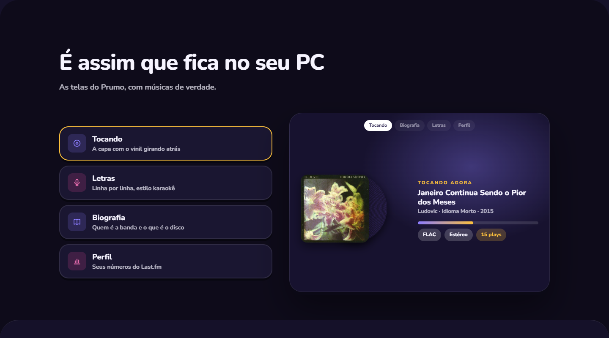

# Prumo Player

Player de música para Windows.

[](https://prumo-player.vercel.app)
[](https://prumo-player.vercel.app)
[](https://prumo-player.vercel.app)

Este repositório é um estudo de caso: documenta a arquitetura e as decisões técnicas do Prumo
Player. O código-fonte é fechado e não está aqui.

Download: https://prumo-player.vercel.app


## Resumo

| | |
|---|---|
| Status | Publicado · gratuito · atualização automática |
| Plataforma | Windows 10 e 11 |
| Papel | Projeto solo · produto, front-end, back-end nativo, distribuição |
| Tamanho | ~17 mil linhas de Rust · ~7 mil de Svelte e TypeScript |
| Desenvolvimento | Agentes de IA (Claude Code) · TDD · revisão de código por etapa |


## Funcionalidades

| Área | |
|---|---|
| Áudio | FLAC, MP3, AAC, ALAC, Opus, OGG, WAV · gapless · equalizador de 10 bandas · ReplayGain e EBU R128 · escolha de dispositivo |
| Biblioteca | Varredura de pastas · tags · capas · playlists automáticas · fila salva · contagem de plays |
| Conteúdo | Letra sincronizada estilo karaokê · biografia do artista · rádio de parecidos · retrospectiva por período |
| Explorar | Ouvir online o que não está na biblioteca · favoritar e pôr em playlist · álbum inteiro · baixar para o PC |
| Ouvir junto | Mesma música ao mesmo tempo, cada um no seu PC · fila compartilhada · convite por link · cópia temporária da música rara |
| Controle pelo celular | Página no navegador do celular, no mesmo Wi-Fi, pelo QR code · tocar, pular, buscar e escolher |
| Integrações | Last.fm (scrobble e perfil) · Discord Rich Presence · controles de mídia do Windows |
| Sistema | Bandeja · instância única · atalhos globais · mini players · timer para dormir |


### Novidades da 0.8.0

**Ouvir junto**: a mesma fila tocando para todo mundo, cada um no seu PC. Quem criou manda o link e vê quem está ouvindo.



| Controle pelo celular | Retrospectiva por período |
|---|---|
|  |  |

## Arquitetura

```
   ┌──────────────────────────────┐
   │  Interface (Svelte + TS)     │  telas, fila, letras, perfil
   └──────────────┬───────────────┘
                  │ comandos e eventos Tauri
   ┌──────────────▼───────────────┐
   │  App Tauri 2 (Rust)          │  janelas, bandeja, atalhos,
   │                              │  Last.fm, Discord, updater
   └──────┬───────────────┬───────┘
          │               │            ┌─────────────────────┐
 ┌────────▼─────┐  ┌──────▼────────┐   │ Servidor da sala    │
 │ crate engine │  │ crate library │   │ (Cloudflare Worker, │
 │ decodificação│  │ SQLite, tags, │   │ Durable Object)     │
 │ saída, EQ,   │  │ capas, busca  │   │ só no Ouvir junto   │
 │ loudness     │  │               │   └─────────────────────┘
 └──────────────┘  └───────────────┘
   + crates online (busca e streaming) e queue (fila, shuffle, repetição)
```

### Decisões técnicas

#### Motor de áudio próprio em Rust

Decodificação com Symphonia, saída com cpal, reamostragem com rubato e loudness com
ebur128. Separado num crate próprio, sem depender da interface, para testar sozinho.

#### Biblioteca em SQLite

Tags lidas com lofty e guardadas em SQLite (rusqlite). Migrações versionadas com backup do
banco antes de cada mudança.

#### Tauri em vez de Electron

Instalador pequeno e pouca memória: a interface usa o WebView2 que já vem no Windows.

#### Atualização automática assinada

Cada versão é assinada. O app confere a assinatura antes de instalar e só atualiza quando
não tem música tocando.

#### Ouvir junto sem transmitir áudio

Ninguém manda o som: a sessão passa só qual música, em que ponto e se está tocando. Cada
Prumo toca pelo arquivo que tem, senão pela versão online, e acerta a diferença sozinho
(até ~2 s). O PC de quem criou é a fonte da verdade; um servidor pequeno na Cloudflare
(um Durable Object por sala, com WebSocket em hibernação) só repassa as mensagens e não
guarda nada depois. Música que só uma pessoa tem vai como cópia temporária, que some ao
sair.

#### Controle pelo celular sem app

Servidor HTTP e WebSocket dentro do próprio Prumo, só na rede local, protegido por um
código que vai no QR code. O celular chama a mesma lógica dos botões do PC.

#### Integração com o sistema

Controles de mídia do Windows (souvlaki), Discord Rich Presence com capa do álbum e
scrobble no Last.fm.



## Stack

| Camada | Tecnologia |
|---|---|
| Desktop | Tauri 2 |
| Núcleo | Rust · Symphonia · cpal · rubato · ebur128 |
| Dados | SQLite (rusqlite) · lofty |
| Interface | Svelte · TypeScript · Vite |
| Integrações | Last.fm · Discord · souvlaki |
| Ouvir junto | Cloudflare Workers · Durable Objects · tungstenite |
| Site | HTML · CSS · Vercel |

## Contato

Marcos Alan · [GitHub](https://github.com/nullfeel) · [prumo-player.vercel.app](https://prumo-player.vercel.app)

<sub>Código-fonte fechado. Este repositório contém apenas documentação pública do projeto.</sub>
